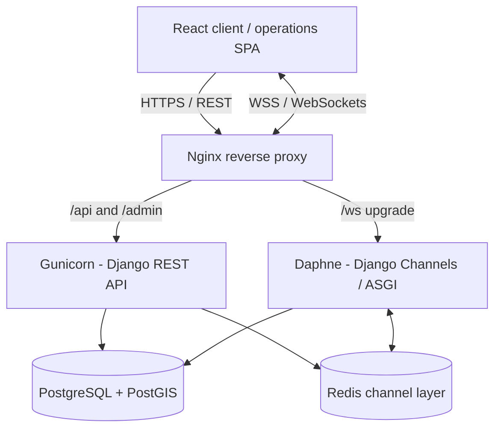

<!--
  Logisticservice README
  Documentation-only update. No application source code is changed by this commit.
-->

<div align="center">

  

  <p><strong>A real-time freight tracking and operations platform.</strong></p>
  <p>Land · Air · Sea</p>

  <p>
    <a href="https://getlogisticservice.com"></a>
    <a href="https://github.com/dieudonne670/logisticservice"></a>
  </p>

  <p>
    
    
    
    
    
    
  </p>

  <p><em>Shipment visibility and customer communication, brought together in one platform.</em></p>

</div>

---

## ✨ Overview

**Logisticservice** is a freight-forwarding and shipment visibility platform designed to help logistics operators manage shipments while giving clients a simple way to follow cargo progress.

The platform brings together a public tracking experience and an authenticated operations workspace. Clients can look up a shipment using its tracking number, view shipment information and location updates, and communicate with operations. Staff can manage shipments, monitor movement, and respond to client messages.

The project explores a practical engineering challenge: **how to deliver timely shipment updates and two-way communication without requiring every client to maintain a permanent real-time connection from a mobile device.**

## 🚀 Platform

| Experience | What it provides |
| --- | --- |
| **Public tracking** | Shipment lookup using a tracking number, shipment summary, map view and client chat |
| **Operations workspace** | Authenticated shipment management, status updates, tracking visibility and client communication |
| **Live location updates** | Location ingestion through an HTTP API and browser updates over WebSockets |
| **Freight coverage** | Land, air and sea shipment workflows |

- **Live platform:** [getlogisticservice.com](https://getlogisticservice.com)
- **Operations sign-in:** [getlogisticservice.com/login](https://getlogisticservice.com/login)

> **Demo access:** No administrator username or password is published in this repository. If a demonstration account is available, request temporary access from the project owner. Never use sample credentials as production credentials.

## 🧭 How it works

At a high level, the system separates ordinary HTTP requests from long-lived real-time connections.

1. A driver device or authorized operations tool submits a shipment location update to the Django API.
2. Django stores the location in PostgreSQL/PostGIS.
3. The application publishes an update to the relevant shipment channel group.
4. Redis distributes the event to connected WebSocket consumers.
5. The browser receives the update and refreshes the shipment marker on the map.

This design keeps location ingestion separate from browser delivery. A driver's device does not need to maintain a WebSocket connection to every client watching a shipment.

## 🏗️ Architecture



### Why Gunicorn and Daphne?

The documented deployment uses two application servers for different workloads:

- **Gunicorn** handles synchronous HTTP requests served by Django REST Framework.
- **Daphne** handles ASGI connections, including WebSockets through Django Channels.
- **Nginx** routes HTTP and WebSocket traffic to the appropriate upstream.
- **Redis** acts as the Channels channel layer, distributing events between application processes.

Both application servers use the same Django project codebase.

## 🧰 Technology stack

| Layer | Technology | Responsibility |
| --- | --- | --- |
| Language | Python 3.12 | Backend development |
| Web framework | Django 6.1 + Django REST Framework | Application and REST API |
| Authentication | SimpleJWT | Token-based SPA authentication |
| Real-time | Django Channels 4 | WebSocket consumers |
| Channel layer | Redis 7 + channels_redis | Cross-process event delivery |
| Database | PostgreSQL 16 + PostGIS | Relational and geospatial data |
| Frontend | React 18 + Vite | Client and operations interface |
| Maps | Leaflet | Shipment map presentation |
| HTTP server | Gunicorn | Synchronous HTTP workloads |
| ASGI server | Daphne | WebSocket and ASGI workloads |
| Reverse proxy | Nginx | Routing, static files and TLS termination |
| Process manager | systemd | Service supervision |
| TLS | Let's Encrypt + Certbot | HTTPS certificates |
| Server OS | Ubuntu 24.04 LTS | Deployment environment |

## 🧩 Backend components

The Django project is organized around the following application areas:

| App | Responsibility |
| --- | --- |
| `core` | Custom user model and role information |
| `shipments` | Shipment records, serializers, admin and tracking endpoints |
| `locations` | Location ingestion and geospatial location records |
| `tracking` | Tracking and chat WebSocket consumers and routing |
| `chat` | Message persistence and conversation endpoints |

### Core data concepts

- **Shipment:** shipment reference, origin, destination, dimensions, freight type, status, and shipper/receiver details.
- **LocationPoint:** a PostGIS point using SRID 4326 (WGS84), associated with a shipment.
- **Message:** a persisted conversation message associated with an administrator or a client sender label.

### Real-time location flow

```text
Driver device / operations tool
             |
             | HTTP POST: shipment location
             v
       Django API
             |
             v
    PostgreSQL + PostGIS
             |
             v
     Django Channels
             |
             v
       Redis channel layer
             |
             v
  Shipment WebSocket subscribers
             |
             v
      Leaflet map in browser
```

### WebSocket access model

The implementation described by this repository uses a custom `JWTAuthMiddleware` for authenticated WebSocket connections. Public tracking connections and chat connections follow different access rules. The chat consumer checks that the supplied tracking number corresponds to the shipment room.

**Security note:** a tracking number should be treated as a sensitive access token if it grants access to shipment information or conversations. Use high-entropy, unguessable references, enforce authorization server-side, rate-limit lookup and chat endpoints, and avoid exposing personal or operational data to anyone who only guesses a shipment identifier.

## 🖥️ Screenshots

The following screenshots are included in the repository's existing README documentation.

### Public shipment tracking

<p align="center">
  
</p>
<p align="center">
  
</p>

### Operations console

<p align="center">
  
</p>
<p align="center">
  
</p>

### Live map controls

<p align="center">
  
</p>

### Client and operations chat

<p align="center">
  
</p>
<p align="center">
  
</p>

## ☁️ Deployment notes

The existing deployment documentation describes a Linux VPS environment with the following components:

| Component | Documented configuration |
| --- | --- |
| Operating system | Ubuntu 24.04 |
| Compute | 3 vCPU, 4 GB RAM, 60 GB NVMe |
| Database | PostgreSQL 16 + PostGIS, bound to localhost |
| Channel layer | Redis 7 |
| HTTP application server | Gunicorn, 3 workers, Unix socket |
| ASGI application server | Daphne on 127.0.0.1:8002 |
| Reverse proxy | Nginx |
| TLS | Let's Encrypt + Certbot |
| Process supervision | systemd |
| Backups | Nightly `pg_dump` archive, with 30-day rotation |

The deployment notes describe Nginx routing `/api/` and `/admin/` to Gunicorn, and `/ws/` to Daphne. React's built assets are served from the frontend distribution directory.

> Infrastructure details describe the deployment documented for this project. Verify the live server configuration before using these values as a deployment recipe for another environment.

## 🔐 Security practices

Security is especially important for a platform that handles shipment locations, customer details and operational conversations.

- Keep Django secret keys, database credentials, JWT signing keys and service credentials outside source control.
- Store production configuration in protected environment files or a secrets manager; restrict file permissions.
- Keep `DEBUG=False` in production and configure allowed hosts and trusted origins explicitly.
- Enforce HTTPS and secure cookie settings wherever cookies are used.
- Validate and authorize every shipment, location and chat request on the server.
- Treat tracking references as sensitive; make them unguessable and rate-limit public lookup endpoints.
- Apply appropriate retention and access controls to location history and customer messages.
- Keep dependencies patched and monitor application, proxy and system logs.
- Test backup restoration, not just backup creation.
- Never publish real credentials, private customer data, tokens or production configuration in screenshots or documentation.

If any real credential has ever been committed to Git history, remove it from active use and rotate it. Deleting it from the latest README alone does not invalidate an exposed credential or erase older Git history.

## 🛠️ Run locally

### Prerequisites

- Python 3.12
- PostgreSQL 16 with PostGIS
- Redis 7
- Node.js 20
- Git

### 1. Clone the repository

```bash
git clone https://github.com/dieudonne670/logisticservice.git
cd logisticservice
```

### 2. Set up the backend

```bash
python -m venv venv
source venv/bin/activate
pip install -r requirements.txt
```

Create a local `.env` file based on the project's `.env.example` and provide your own development database, Redis and Django settings. Do not commit your `.env` file.

### 3. Prepare the database and run Django

```bash
python manage.py migrate
python manage.py createsuperuser
python manage.py runserver
```

The Django development server is available at [http://127.0.0.1:8000](http://127.0.0.1:8000).

### 4. Start the frontend

Open another terminal:

```bash
cd frontend
npm install
npm run dev
```

Vite normally serves the frontend at [http://localhost:5173](http://localhost:5173).

### 5. Run the ASGI server for WebSocket testing

For a closer ASGI development setup, run:

```bash
daphne -b 0.0.0.0 -p 8001 config.asgi:application
```

Make sure the frontend's API and WebSocket URLs match your local backend ports and that the required Django, PostgreSQL and Redis services are running.

## 📁 Repository structure

The following is the project structure documented for this repository:

```text
logisticservice/
├── config/                 # Django settings, ASGI and URLs
│   ├── asgi.py
│   ├── settings.py
│   ├── urls.py
│   └── ws_auth.py          # JWT WebSocket middleware
├── core/                   # Custom user model
├── shipments/              # Shipment models and API
├── locations/              # PostGIS location ingestion
├── tracking/               # WebSocket consumers and routing
├── chat/                   # Conversation and message handling
├── frontend/               # React + Vite application
│   ├── src/
│   │   ├── admin/
│   │   ├── auth/
│   │   ├── chat/
│   │   ├── map/
│   │   ├── shipments/
│   │   └── pages/
│   └── public/
├── requirements.txt
├── .env.example
└── README.md
```

## 🗺️ Roadmap

The original project notes identify these areas for future development:

- [ ] Shipment document uploads (bills of lading and customs paperwork)
- [ ] Multi-tenant support for multiple logistics companies
- [ ] Driver mobile application with background GPS tracking
- [ ] Webhook notifications for shipment milestones
- [ ] Route optimization using OSRM and VROOM
- [ ] Docker Compose setup for local development
- [ ] CI/CD automation with GitHub Actions

## 🧠 Engineering challenges

A few of the interesting engineering topics explored in this project:

1. **Sync and async integration:** using Django's synchronous ORM safely from asynchronous Channels consumers.
2. **WebSocket authentication:** authenticating browser connections and separating public tracking access from protected chat operations.
3. **Resource authorization:** serving public tracking and authenticated operations workflows while enforcing server-side access rules.
4. **NAT-aware deployment:** configuring reverse-proxy routing and certificate issuance in a VPS environment behind a shared gateway.
5. **Efficient real-time updates:** separating HTTP location ingestion from WebSocket fan-out to connected browsers.

## 👨‍💻 Author

**Dieudonne Kindong**  
Backend Engineer · Python · Django · FastAPI · Systems & Infrastructure

- GitHub: [@dieudonne670](https://github.com/dieudonne670)
- Open to: Backend engineering (Python, Django, FastAPI) and platform engineering opportunities.

---

<div align="center">

  <p><strong>Thanks for checking out Logisticservice.</strong></p>
  <p>Built around a simple idea: better visibility makes logistics easier to manage.</p>
  <p><sub>Documentation maintained in the repository README.</sub></p>

</div>
